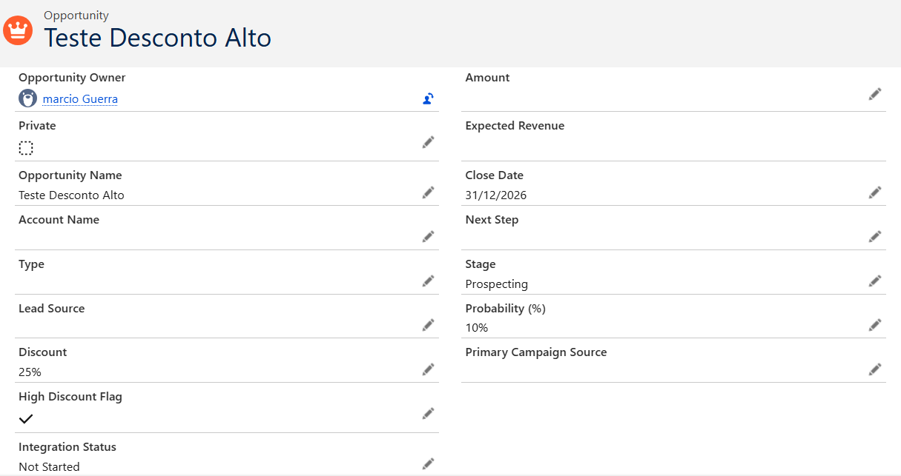
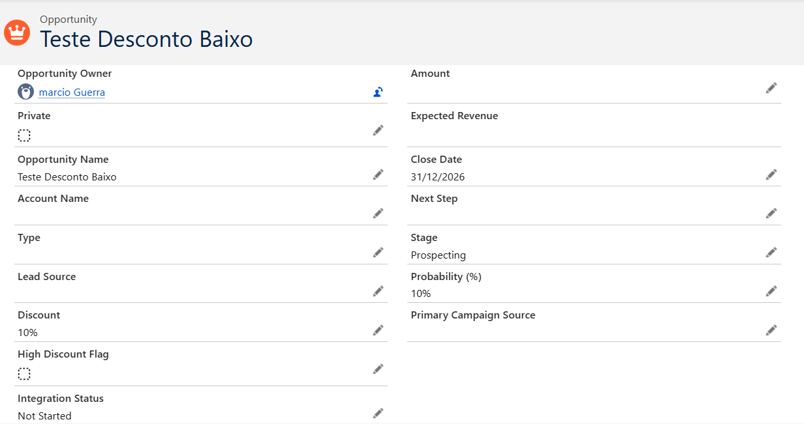
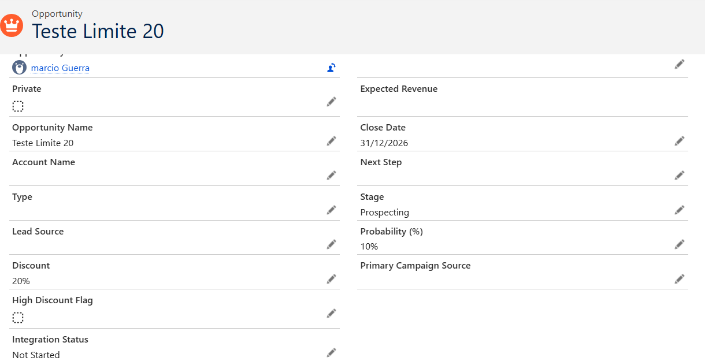

# Testes de QA: Flow de Desconto Alto no Salesforce

Projeto de estudo de QA feito no Trailhead Playground (Salesforce Developer Edition).

## Objetivo

Criar e validar uma automação (Record-Triggered Flow) que marca o campo **High Discount Flag** na Oportunidade quando o **Discount** é maior que 20%.

## O que foi criado no Salesforce

**Campos personalizados na Oportunidade**

| Campo | API Name | Tipo |
|---|---|---|
| Discount | Discount__c | Percent (3, 0) |
| High Discount Flag | High_Discount_Flag__c | Checkbox |
| Integration Status | Integration_Status__c | Picklist (Not Started, Logged, Error) |

**Flow:** Opportunity High Discount Flags (Record-Triggered Flow)

- Objeto: Opportunity
- Gatilho: registro criado ou atualizado
- Condição de entrada: Discount maior que 20
- Executa a cada atualização que atende à condição
- Otimizado para: Fast Field Updates
- Ação: Update Triggering Record, High Discount Flag = True

## Regra de negócio

> Se o desconto da Oportunidade for maior que 20%, o campo High Discount Flag deve ficar marcado.

## Casos de teste

| ID | Cenário | Técnica | Discount | Resultado esperado | Resultado obtido | Status |
|---|---|---|---|---|---|---|
| CT01 | Desconto alto | Partição de equivalência | 25% | Flag marcado | Flag marcado | Passou |
| CT02 | Desconto baixo | Partição de equivalência | 10% | Flag desmarcado | Flag desmarcado | Passou |
| CT03 | Valor-limite | Análise de valor-limite | 20% | Flag desmarcado | Flag desmarcado | Passou |

Em todos os casos, o Integration Status nasceu como **Not Started** (valor padrão).

## Evidências

**CT01: desconto alto (25%), Flag marcado**

**CT02: desconto baixo (10%), Flag desmarcado**

**CT03: valor-limite (20%), Flag desmarcado**

## Passos de execução (exemplo: CT01)

1. Abrir o app Sales e clicar em Opportunities, depois New.
2. Preencher Opportunity Name, Close Date (31/12/2026), Stage (Prospecting) e Discount (25).
3. Clicar em Save.
4. Abrir a aba Details e conferir o campo High Discount Flag.

## Próximos testes planejados

- Valor-limite superior: Discount = 21 (deve marcar)
- Atualização de registro: alterar o desconto de 10 para 30 (deve marcar)

## Ferramentas

- Salesforce Trailhead Playground (Developer Edition)
- Flow Builder
- Testes manuais
